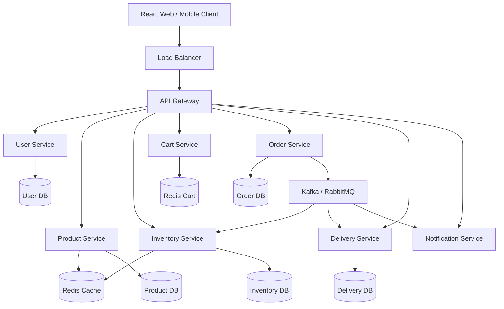

# High-Level Design (HLD)

## 1. Requirements
### Functional
- Search products and browse categories.
- Check stock in a nearby store.
- Manage a cart.
- Place orders and reserve stock.
- Assign delivery partners and track delivery status.

### Non-functional
- Low response latency.
- Horizontal scalability during peak hours.
- Consistent inventory and orders.
- Fault tolerance, observability and secure communication.

## 2. Architecture

The current repository implements a modular FastAPI backend and React frontend. The separate services, gateway, Redis and broker in the architecture are the target scalable deployment design; they are not all deployed as independent services in this MVP.

## 3. Service responsibilities
- **User:** accounts, profiles, authentication.
- **Product:** catalog, categories, search.
- **Inventory:** store-specific stock and reservations.
- **Cart:** selected products and quantities.
- **Order:** order lifecycle, totals and idempotency.
- **Delivery:** partner assignment and status.
- **Notification:** order confirmations and delivery messages.

## 4. Database selection
- PostgreSQL for users, products, inventory, orders and delivery because relational integrity and transactions are valuable.
- Redis for hot product/search cache and short-lived carts.
- Kafka or RabbitMQ for asynchronous events.
- MongoDB can be used as an alternative document database for catalog/order prototypes. This MVP optionally connects to MongoDB but currently keeps operational demo state in memory.

## 5. Caching
Use Redis cache-aside for product detail and popular search queries. Use short TTLs for inventory. Invalidate or update keys when product or stock data changes. Always validate stock against the authoritative inventory store before confirming an order.

## 6. Messaging
Publish events such as `OrderPlaced`, `InventoryReserved`, `InventoryUpdated`, `DeliveryAssigned` and `OrderDelivered`. Consumers should be idempotent, retry transient failures with backoff, and send repeatedly failing events to a dead-letter queue.

## 7. Scalability and reliability
- Horizontally scale stateless service instances behind a load balancer.
- Apply rate limiting and request timeouts at the gateway.
- Use database indexes and partition large order tables.
- Use atomic inventory reservations and idempotency keys to avoid overselling and duplicate orders.
- Add health checks, metrics, distributed tracing and centralised logs.
- Use asynchronous processing for notifications and delivery assignment.
- Add circuit breakers, bounded retries and dead-letter queues.
- Deploy across multiple availability zones and back up persistent databases.

## 8. Important trade-offs
A modular monolith is simpler for a student MVP and easier to test. A service-oriented architecture is more appropriate when teams and traffic grow, but it introduces distributed transaction, observability and deployment complexity. The design should evolve based on measured load rather than splitting everything into microservices prematurely.
